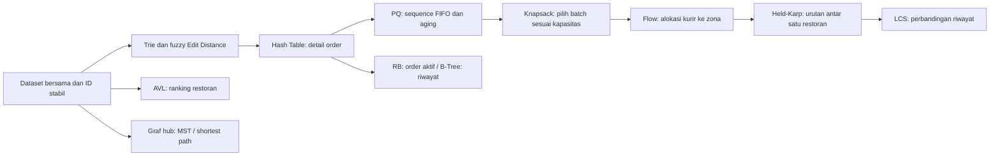

# Rencana UAS — Smart Delivery & Order Optimization, Kelompok 1

Dokumen kerja ini meneruskan naskah UTS tanggal 6 Oktober 2026. Pembagian mengikuti
**tabel pemateri dan bagian teknis**, sesuai pilihan tim; Slide 02 berbeda dan
tidak digunakan sebagai acuan. Nama di sini mengikuti ejaan pada naskah.

## Dasar keputusan dan kondisi awal

Sumber lokal:

- [Guideline UAS](../Materi/Guideline_UAS_Data_Structure_and_Algorithm.pdf), khususnya hlm. 3–15.
- [Naskah UTS](<../Materi/Naskah Presentasi Final — Kelompok 1.pdf>), hlm. 1 dan 3–9.
- [PPT UTS](<../Materi/UTS DSA Kelompok 1 — Smart Delivery & Order Optimization.pptx.pdf>),
  slide 7 menyebut Max-Heap; bagian lain masih mencampur Min-Heap.
  Tim memilih Max-Heap; [keputusan dan daftar koreksi](MAX_HEAP_DECISION.md).

UTS berfokus pada lima modul dan 18 kode test case. UAS mengharuskan **12 sesi**
(1–7, 9–13), implementasi manual, satu aplikasi terintegrasi, pengujian, eksperimen,
laporan IMRAD, klaim-bukti PPT, dan QnA individual. Tidak ada modul Sesi 8.

Bobot: implementasi/pembuktian 70, antarmuka/integrasi 5, laporan 12, presentasi 8,
defense individual 5. Per sesi: implementasi 40%, bukti 25%, kompleksitas 20%,
integrasi 15%. Level 1 dibatasi 60% bobot, Level 2 85%, Level 3 100% (hlm. 4–5).
Karena itu **prioritaskan semua sesi minimal berjalan**, lalu seluruh Level 2,
dan naikkan Level 3 setelah bukti tersedia. UI bagus saja tidak menutup sesi kosong.

Saat peninjauan awal: seluruh inti MinHeap, HashTable, Trie, AVL, Held-Karp masih
`NotImplementedError`; tes awal **5 passed, 35 failed**. UI, wiring service,
generator, baseline dan runner eksperimen tersedia. Perubahan penyiapan UAS
menambahkan kontrak kerja, dashboard dan pendukung; **belum menyelesaikan 12 sesi**.
Smoke test lama yang bertuliskan “Siap” tidak berarti memenuhi rubrik satu sesi.

Pembaruan setelah evaluasi tampilan: fondasi UTS telah diimplementasikan dan
62 tes lulus setelah perbaikan demo order. Beranda memakai kartu sembilan nama; menu Bagian Individu memuat
tugas, urutan presentasi, demo interaktif, file serta bukti. Halaman order,
Search, Ranking, dan Delivery Route sudah memakai implementasi asli. Perluasan
UAS tetap belum selesai; lihat kontrak/file dan target tiap sesi untuk sisanya.

## Pembagian presentasi sesuai tabel UTS

Tabel berikut merupakan acuan yang dikoreksi pengguna. Pembagian ini tidak
memberikan tugas Flow kepada Atika, MST kepada Husnu, Greedy/Knapsack kepada
Eka, atau Shortest Path kepada Daffa.

| Pemateri | Slide UTS | Materi | Durasi |
| --- | --- | --- | --- |
| Atika | 01–04 | Pembukaan, tim, background, problem statement | 3,5 menit |
| Husnu | 05–06 | Objectives, functional requirements, arsitektur | 3,5 menit |
| Eka | 07–08 | Pemetaan fitur ke struktur data | 2,5 menit |
| Febri Anggoro | 09–10 | Heap & Priority Queue | 2,5 menit |
| Rigan | 11–12 | Hash Table | 2,5 menit |
| Rendi | 13–14 | Trie | 2,5 menit |
| Febri Andri | 15–16 | AVL Tree | 2,5 menit |
| M Febri | 17–18 | Dynamic Programming | 3,5 menit |
| Daffa | 19–20 | Complexity, testing, eksperimen | 3,5 menit |
| Atika | 21–22 | Timeline, kesimpulan, referensi | 1,5 menit |
| **Total** | | | **28 menit** |

Slide dan durasi tersebut adalah acuan UTS. Adaptasi durasi/jumlah slide UAS
mengikuti ketentuan dosen; peran tiap anggota tetap sesuai tabel.

## Alokasi implementasi dan tambahan UAS

Fondasi yang sesuai bagian teknis: S1–S2 Febri Anggoro, S3 Rigan, S4 Rendi,
S5 Febri Andri, S7 M Febri. Peran Atika, Husnu, Eka, dan Daffa tetap mengikuti
tabel presentasi. Daffa mengoordinasikan analisis kompleksitas, tes dan eksperimen
bersama pemilik modul; Husnu menjelaskan arsitektur dan kebutuhan sistem; Eka
menjelaskan pemetaan seluruh fitur ke struktur data; Atika membuka dan menutup.

S6 (RB/B-Tree), S9 (DP lanjut), S10 (Greedy), S11 (MST), S12 (Shortest Path),
dan S13 (Flow) tetap wajib dicakup untuk UAS. **Pemilik tambahan dan reviewer
belum ditentukan**. Daftar file/kontrak tetap tersedia agar tim dapat membagi
pekerjaan setelah menyepakati alokasinya. Jangan menganggap pembagian otomatis
berdasarkan kategori sebagai keputusan tim. Peta `src/uas.py` dan dashboard
menampilkan status belum ditentukan secara eksplisit.

## Paket hasil wajib setiap pemilik

1. Implementasi manual sesuai kontrak, validator invarian, dan trace proses kecil.
2. Unit test input normal, kosong/tidak ditemukan, duplikat, dan edge case algoritma;
   oracle/brute force serta satu integrasi bisnis. S13 minimal **5 kasus** (hlm. 10).
3. Skrip eksperimen, seed, raw CSV, metadata mesin, ≥5 pengulangan, median,
   satu warm-up, dan definisi apa yang dihitung. Memori dan waktu diukur terpisah.
4. Dua gambar (visual proses dan screenshot nyata), satu tabel per sesi; grafik
   untuk minimal delapan sesi (hlm. 13). Setiap gambar diberi interpretasi.
5. Methods enam unsur: desain/invarian, pseudocode, kompleksitas, mapping bisnis,
   prosedur tes, prosedur eksperimen. Results dan Discussion ditulis pemiliknya.
6. Slide A klaim+desain dan B bukti; rujukan nomor gambar/tabel laporan. Demo
   input kecil yang bisa dijelaskan langkah per langkah dan rekaman cadangan.
7. Commit/PR sendiri dengan reviewer, kontribusi faktual, dan latihan QnA.

Peran presentasi mengikuti tabel. Seluruh anggota tetap perlu mempelajari alur
sistem dan hasil pengujian lintas modul untuk defense individual (hlm. 16).
Bagian non-algoritma dibuktikan melalui arsitektur, kebutuhan, pemetaan fitur,
metode eksperimen, hasil dan kesimpulan yang sesuai implementasi.

## Alur data dan keputusan integrasi

Diagram tersebut adalah **target integrasi**, belum seluruhnya berjalan. Bridge
yang sudah tersedia: `DeliveryService.matrix_for_orders` mengambil koordinat
restoran dan order dari dataset yang sama; pemilihan batch belum mengubah status.
Halaman rute juga mempertahankan mode peta sintetis untuk eksperimen terisolasi.

- Satu session dataset di `src/ui.py`. Semua menu memanggil service; algoritma
  tidak mengimpor Streamlit. Jangan membuat generator berbeda di setiap halaman.
- `Order.heap_key()` tetap untuk MinHeap lama. Dispatcher memakai MaxHeap dengan
  `(4-level, -created_at, -sequence, order_id)`: Urgent berskor 3, High 2, Normal 1.
  Timestamp lebih awal menang, sequence memutus timestamp sama tanpa bergantung ID.
  Waktu harus konsisten dalam satu batch; menit sejak awal hari belum aman lintas hari.
  Kontrak aging UAS memakai `(effective_score, -sequence, order_id)` pada jam
  simulasi monotonik; implementasi aging masih TODO.
- Aging bergantung pada jam simulasi monotonik; nyatakan biaya rebuild O(n).
  Uji 50 kejadian (bukan hanya trace lima baris untuk screenshot).
- Hash chaining tetap default UTS. Probing merupakan implementasi pembanding,
  bukan pengganti diam-diam. Open addressing/tombstone wajib untuk target Level 2.
- Trie `starts_with` lama tetap alfabetis; tambah API baru untuk popularitas.
  Biaya autocomplete harus memperhitungkan karakter/node yang dikunjungi dan
  panjang output, bukan mengklaim O(L+k) tanpa definisi k.
- AVL memiliki `check_avl()` untuk BST, stored height, ukuran dan balance;
  gunakan validator ini, bukan hanya `is_balanced()` yang memeriksa balance.
- RB menyimpan order aktif. B-Tree menyimpan riwayat dengan `(completed_at,
  order_id)`. Tambahkan transisi complete-order di service untuk mengisi riwayat;
  data model lama belum memiliki completed_at. Jangan menganggap processing=done.
- Knapsack memakai unit kapasitas integer, nilai bisnis terdefinisi, dan mapping
  indeks hasil ke order_id. Berat, durasi, deadline, zona dan kapasitas kurir
  **belum ada** dalam dataset lama; penanggung jawab integrasi menambah metadata berdasar ID
  di adapter bersama, dengan seed/distribusi terdokumentasi dan default kompatibel.
- Held-Karp tetap masalah UTS: start restoran, tanpa kembali, satu restoran per
  batch, maksimal 15 customer. Tambah memoization dengan hasil kompatibel;
  masalah ini berbeda dari Knapsack/LCS/Edit Distance S9 sesuai hlm. 10.
- Greedy yang dipilih: EDD meminimalkan **maximum lateness** pada satu mesin/kurir,
  semua job tersedia t=0, durasi tetap, tanpa travel bergantung urutan. Nyatakan
  asumsi sebelum bukti exchange. Nearest-first untuk rute hanya heuristik;
  jangan mengklaim selalu optimal. Gunakan greedy ratio vs 0/1 DP sebagai contoh gagal.
- MST memakai graf undirected biaya koneksi, bukan rute mengunjungi customer.
  Prim menggunakan heap manual tim, dengan adapter key numerik/vertex.
- Bellman-Ford/Floyd memakai graf directed **biaya** dengan promo negatif.
  Menit perjalanan tidak negatif; pisahkan dari matriks waktu Held-Karp.
  Pair yang terpengaruh negative cycle tidak punya shortest path finite.
- Flow memakai kapasitas integer, bukan biaya perjalanan. Network:
  source→kurir (kapasitas kurir)→zona kompatibel→sink (jumlah permintaan).
  Max-flow memaksimalkan jumlah alokasi, tidak otomatis meminimalkan waktu/jarak.
- Perbandingan AVL/RB/B-Tree memakai **key dan workload sama** pada eksperimen,
  walaupun aplikasi bisnis menggunakan key berbeda. Page read B-Tree adalah
  simulasi node access selama tidak ada penyimpanan disk nyata.

## Tahap kerja dan batas selesai

1. Sepakati kontrak file dan metadata bersama; setiap anggota membuat branch.
2. Selesaikan Level 1 seluruh sesi beserta tes/oracle; gabungkan dependency
   Hash+Heap dahulu, lalu Trie/AVL/DP, RB/B-Tree, Greedy dan graf/flow.
3. Husnu menyambungkan service dan UI per fitur, satu alur bisnis bersama.
   Tambahkan menu untuk indeks, DP lanjut, Greedy, Network, Allocation; saat ini
   kontrak file tambahannya tersedia tetapi menu eksekusi algoritma itu belum dibuat.
4. Pemilik melengkapi Level 2, validator dan trace; Daffa review lintas modul.
5. Jalankan eksperimen; pilih Level 3 dengan bukti yang realistis. Baru isi klaim
   PPT dan angka abstrak dari hasil nyata.
6. Atika menyatukan IMRAD, seluruh anggota mereview angka dan latihan defense.

Definisi selesai sesi: tes/oracle lulus, validator lulus, service+UI dapat
menjalankan kasus bisnis yang sama, eksperimen dapat diulang, visual+screenshot+
tabel tersedia, klaim tidak melampaui bukti, slide A+B dan Methods/Results selesai,
reviewer sudah mencoba demo. Jangan xfail/skip untuk membuat suite terlihat hijau.

## Git dan kontribusi

Branch yang disarankan: `feat/s01-s02-priority`, `feat/s03-hash`, `feat/s04-search`,
`feat/s05-avl`, `feat/s06-rbtree`, `feat/s06-btree`, `feat/s07-route`,
`feat/s09-knapsack`, `feat/s09-lcs`, `feat/s09-edit-distance`, `feat/s10-greedy`,
`feat/s11-mst`, `feat/s12-shortest-path`, `feat/s13-flow`, `feat/integration`.
Satu PR fokus satu bagian; pemilik lain boleh mengerjakan branch berbeda.

Pemilik mengubah file modulnya dan test terkait; perubahan `models.py`, `ui.py`,
generator, dan signature service dibahas di PR integrasi dengan Husnu agar tidak
konflik. Review silang, tidak push langsung main. Catat perubahan dari UTS di
Discussion. Tabel kontribusi menyebut file/PR/bukti yang benar-benar dikerjakan,
bukan hanya pembagian rencana. Nyatakan penggunaan AI dan bantuan lain (hlm. 16).

## Presentasi semua anggota

Gunakan urutan dan peran pada tabel UTS di atas. Atika membuka dan menutup;
Husnu menjelaskan tujuan/kebutuhan/arsitektur; Eka memetakan fitur; lima pemateri
teknis menjelaskan modul masing-masing; Daffa menyampaikan kompleksitas,
pengujian dan eksperimen. Materi tambahan UAS belum memiliki pemateri yang
disepakati dan perlu dimasukkan setelah pembagian tambahan diputuskan.

Durasi acuan UTS 28 menit tidak otomatis menjadi durasi resmi UAS. Setelah
ketentuan dosen jelas, sesuaikan panjang bagian dan bukti tanpa mengganti peran
utama. Rekaman demo cadangan disiapkan dari eksekusi nyata.

## Ketentuan PDF yang perlu dikonfirmasi ke dosen

| Pokok | Ketentuan pertama | Ketentuan lain | Rencana konservatif tim |
| --- | --- | --- | --- |
| Tanggal | Hlm. 1: UAS dan batas pengumpulan 27 Oktober 2026 | Hlm. 16: source/laporan 31 Oktober 2026 | Siap untuk tanggal lebih awal, 27 Oktober; konfirmasi tanggal resmi |
| Durasi | Hlm. 14: 40 menit + QnA 20 menit | Hlm. 16: 30 menit; jumlah blok hlm. 14 sendiri 48 menit | Latih versi 30 dan 40 menit |
| Laporan | Hlm. 12: minimal 15 halaman di luar cover/lampiran | Hlm. 18: checklist ≥30 halaman | Target ≥30 halaman isi yang bermakna, konfirmasi minimum |
| Slide | Hlm. 14: sekitar 15–20 slide | Hlm. 14: dua slide tiap sesi berarti ≥24 slide sebelum opening | Siapkan A+B seluruh 12 sesi, konfirmasi batas slide |

Catatan di atas berasal dari dokumen yang diberikan; belum ada konfirmasi dosen.
Tidak ada pesan ke dosen yang dikirim oleh alat atau proyek ini.
